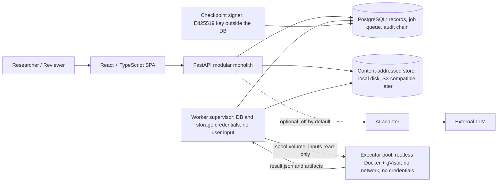
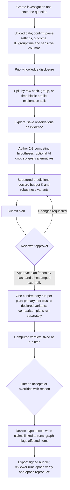

# EPOCH — Final System Architecture (Consolidated)

**Product:** An analysis workspace that keeps research honest by construction
**Prepared:** 12 November 2026 · **v2:** corrections L56–L66 applied (see [§21](#21-v2-corrections-l56l66))
**Status:** Consolidated architecture proposal for team adoption. Supersedes the separate architecture, optimal-solution, and additional-innovations drafts, and v1 of this document.
**Sources merged:** README, CHANGES, Ideation and Research, Website Architecture, Optimal Solution, Review and Loopholes (L1–L55), Additional Solution Design (three capabilities and a benchmark), Additional Contributions summary, and the earlier consolidated PDF.
**Not a claim of implementation.** This is a proposed design. Nothing here has been built, load-tested, or security-certified.

---

## Contents

1. [What this document decides](#1-what-this-document-decides)
2. [What was kept from each source, and how conflicts were resolved](#2-what-was-kept-from-each-source-and-how-conflicts-were-resolved)
3. [Scope tiers and the cut line](#3-scope-tiers-and-the-cut-line)
4. [System architecture](#4-system-architecture)
5. [Scalability path](#5-scalability-path)
6. [Website information architecture and user journey](#6-website-information-architecture-and-user-journey)
7. [Integrity core (Core)](#7-integrity-core-core)
8. [Extensions E1–E5](#8-extensions-e1e5)
9. [Data model (single schema)](#9-data-model-single-schema)
10. [Engine interface and test catalogue](#10-engine-interface-and-test-catalogue)
11. [AI design and guardrails](#11-ai-design-and-guardrails)
12. [Security, privacy, and reliability](#12-security-privacy-and-reliability)
13. [Evaluation and benchmark](#13-evaluation-and-benchmark)
14. [Feasibility: build order, ownership, and timeline](#14-feasibility-build-order-ownership-and-timeline)
15. [Acceptance criteria (automated tests)](#15-acceptance-criteria-automated-tests)
16. [Risks and mitigations](#16-risks-and-mitigations)
17. [Open decisions](#17-open-decisions)
18. [Glossary](#18-glossary)
19. [Loophole coverage map](#19-loophole-coverage-map)
20. [References](#20-references)
21. [v2 corrections (L56–L66)](#21-v2-corrections-l56l66)

---

## 1. What this document decides

The earlier documents agree on the product and differ on emphasis. The base documents and the review make **integrity** the product. The additional proposal adds **breadth**: competing explanations, robustness testing, an evidence graph, and a benchmark.

Breadth is valuable only if it cannot undermine the integrity guarantees, and a student team has to be able to build it. This document therefore makes four decisions:

1. **Integrity core first.** Sealed split, structured predictions, frozen plans, a fixed test budget, computed verdicts, a complete run ledger, and a signed, reproducible bundle. Nothing else ships before this works end to end.
2. **Each new capability is rebuilt so it obeys the core.** Competing explanations share one test budget. Robustness variants are declared before freezing. The evidence graph is derived from existing records. The benchmark runs the real engine.
3. **One architecture that scales by replacement, not rewrite.** A modular monolith, Postgres as database and queue, and a stateless executor pool. Each scaling step swaps one component behind an existing interface (§5).
4. **A visible cut line.** Every feature is tagged Core, Extension, or Later, and the build order says what to drop first if time runs short (§3, §14).

**One-line pitch:** *"Jupyter lets you p-hack quietly. EPOCH writes down every attempt."*

**Positioning.** EPOCH is not an autonomous scientist and does not compete with AI hypothesis generators (Co-Scientist, Google Labs, ERA, The AI Scientist). Those systems are strong at generating ideas. The open problem is making results *trustworthy*. EPOCH joins pre-registration, constrained execution, and audit into one **enforced** workflow, and makes questionable research practices impossible or visible. It assists the researcher and records the process; it does not certify truth, guarantee novelty, or replace human judgment.

---

## 2. What was kept from each source, and how conflicts were resolved

### 2.1 Best features kept from each proposal

| Source | Kept as-is | Changed or tightened here |
|---|---|---|
| **Base docs** (Ideation, Website Architecture, README) | Investigation as the central object, allow-listed tests, executor isolation, AI as critic only, page structure, `epoch-engine` with CLI, prior-knowledge disclosure | Page list extended with Compare and Graph views |
| **Optimal Solution and Review (L1–L55)** | Row-hash split per lineage, structured predictions, first-match verdict rules, budget K, post-hoc labels, gVisor pool without Docker socket, audit chain with external checkpoints, signed bundles, security list | Budget K now explicitly covers multi-hypothesis comparison and robustness (§7.3, §8.1) |
| **Additional: Competing Explanations** | Several structured hypotheses per question, compared with approved tests | The system does not "identify" explanations by itself. The AI critic may suggest them, and every suggestion is logged and counted (L39) |
| **Additional: Robustness Stress Tester** | Predefined variations, a Robustness Index, a summary of where findings break | Confirmatory variants are declared before freezing and run inside the same single run. Variants cannot change the primary verdict. The index is a descriptive fraction with its limits stated |
| **Additional: Evidence Graph** | Connected, versioned map of data, evidence, hypotheses, runs, and claims. Impact analysis flags affected conclusions | Edges are derived from foreign keys, so there is no second source of truth. No graph database. Flags never change a status automatically |
| **Additional: Historical Benchmark** | Historical and synthetic datasets, true-positive and false-discovery metrics, a baseline workflow | Split into a fully automated simulation benchmark (cheap, objective) and a small human study (costly). The baseline includes a scripted p-hacking analyst |

### 2.2 Conflicts between documents and their resolutions

| Conflict | Resolution |
|---|---|
| "System identifies competing explanations" versus "AI never writes plans or hypotheses" | A human authors every hypothesis. The AI critic can propose alternatives as review comments. Accepting one creates a human-owned draft. |
| More hypotheses and robustness checks versus one fixed budget K | K is declared once per lineage. Each confirmatory plan (one per hypothesis, plus any comparison or replication plan) uses one unit. Robustness variants declared in the plan use no extra units because they cannot change the verdict. |
| Robustness re-reads the confirmation split versus "single use" | Variants run inside the one confirmatory job. Anything added after the result is labelled post-hoc, is descriptive only, and can never produce "Supported". |
| Robustness Index as a score versus "no unexplained confidence score" (L8) | The index is shown as "k of m valid declared checks agree" beside every individual result. It is never described as a probability. |
| Graph "flags conclusions" versus human responsibility | Flags open a review item. A person acknowledges or resolves it with a reason. The system never edits a status or verdict. |
| Four-test catalogue versus model comparison | A fifth test, `model_comparison`, is added as an Extension. The Core demo works with the original four. |
| Strict one-run holdout versus legitimate need for replication | MVP: one run per plan within budget K. Replication on newly added rows is allowed as a labelled plan (§8.3). A Thresholdout-style reusable holdout is Later (L38). |
| Docs use different names ("Weakened" vs "downgraded", `DataProfile` as table vs JSON) | One glossary (§18) and one schema (§9). |
| Round-1 verdict table ambiguous; growing Holm family; supervisor with `docker.sock`; sha256 split launderable | Replaced by first-match rules, fixed budget K, a pre-started gVisor pool, and row-hash split per lineage (L34, L36, L37, L44). |

---

## 3. Scope tiers and the cut line

**Out of scope throughout:** causal claims from observational data, autonomous publication, wet-lab execution, guaranteeing novelty or truth, and detecting analyses done outside EPOCH (handled by disclosure, not detection).

| Tier | Contents | Rule |
|---|---|---|
| **Core (must ship)** | Sign-in; investigation with owner and reviewer. CSV upload, canonical versioning, lineage, split, prior-knowledge disclosure. Exploration on the exploration split. Structured hypotheses and predictions. Four tests. Approval, freezing, budget K. Isolated single run, computed verdict, run ledger. Hypothesis revisions, claims linked to runs. Audit chain and signed bundle with `epoch verify` and `epoch reproduce`. | Nothing in other tiers ships until Core passes its acceptance tests. |
| **Extension** (build in this order) | **E1** Competing explanations and comparison view. **E2** Robustness (exploratory tier first, then declared confirmatory variants). **E3** Evidence graph (list and impact view first, visual graph second). **E4** Simulation benchmark and red-team suite. **E5** AI critic and narrator. | Each is switchable off. Each must pass its own acceptance tests with the others off. |
| **Later** | Thresholdout-style reusable holdout. Adaptive experiment selection. Cross-domain mechanism transfer. Workspaces and organisation RBAC. Real-time collaboration. Arbitrary code execution. Personal or regulated data. Graph database. | Do not design for these now beyond keeping interfaces clean. |

**If time runs short, drop in this order:** visual graph (keep the list and impact view) → E5 AI → robustness confirmatory tier (keep exploratory sensitivity) → `model_comparison` test → E3 entirely → E2 entirely. Never drop anything in Core.

---

## 4. System architecture

### 4.1 Component view



The `epoch-engine` CLI (`run | verify | reproduce | bench`) is usable without the web stack.

### 4.2 Responsibilities

- **SPA.** Forms, tables, charts, workflow state, report viewer, Compare and Graph views. User Markdown is sanitised with DOMPurify under a strict CSP.
- **API (modular monolith).** Modules: `auth/authz`, `investigations`, `data`, `hypotheses`, `plans`, `runs`, `evidence+graph`, `reports`, `audit`, `ai-adapter`. One authorisation dependency resolves *object → investigation → membership* for every route. State machines for plans and runs. Modules talk through internal interfaces, so any can be split out later.
- **PostgreSQL.** All records; the job queue (`FOR UPDATE SKIP LOCKED` with leases and heartbeats, or the `procrastinate` library); and the audit chain, written by an INSERT-only role. Job state and run records commit in one transaction.
- **Content-addressed store.** Raw uploads, canonical Parquet, artifacts, and bundles, keyed by sha256. Signed download URLs expire in 5 minutes or less.
- **Supervisor.** Claims jobs, puts inputs on the spool volume, validates executor output against a schema, writes results. It **never** holds the Docker socket, and no user input runs inside it.
- **Executor pool.** Pre-started sandboxed containers under gVisor (`runsc`). No network, no credentials, read-only inputs, one output directory, CPU/memory/time limits, `OMP_NUM_THREADS=1`, image pinned by digest. Parsing, profiling, and all analysis run here, never in the API.
- **Each executor runs one job and exits** (L62). A pre-started pool that is reused across jobs loses isolation *between jobs*: a malicious CSV that exploits a parser could persist inside the container and tamper with later results, or read another investigation's data. Each executor therefore has a read-only root filesystem with a `tmpfs` scratch area, sees only **its own job's** spool subdirectory, and exits after one job. The orchestrator's restart policy (Compose `restart: always`, or a Kubernetes Job) brings it back fresh with the scratch area wiped. Still no Docker socket anywhere.
- **AI adapter.** Prompt templates, schema validation, numeric grounding check, citation verification, rate limits, spend cap. It does no statistics.
- **Checkpoint signer.** Periodically signs the audit chain head, optionally with an RFC 3161 timestamp.
- **`epoch-engine`.** A plain Python package of pure functions: `profile`, `split`, `run`, `evaluate`, `robustness`, `compare`, plus the CLI. Tested against golden values cross-checked in R. Its version is the git SHA.

### 4.3 Technology stack

| Layer | Choice | Reason |
|---|---|---|
| Frontend | React, TypeScript, Vite, Plotly; Cytoscape.js or React Flow for the graph | One chart JSON spec for evidence and reports; mature graph libraries |
| Styling | Tailwind CSS **or** CSS modules (pick one) | Avoid decision churn |
| API | Python, FastAPI, Pydantic, SQLAlchemy, Alembic | Same language as the engine; strict per-test parameter models |
| Database and queue | PostgreSQL | One system to run and back up. No Redis |
| Graph | Postgres edge view and recursive CTEs | No separate graph database (§8.3) |
| Storage | Content-addressed, local disk first, S3-compatible later | Immutability and de-duplication come free |
| Analysis | pandas, NumPy, SciPy, scikit-learn, statsmodels **array API only** | No patsy formula strings (L16) |
| Isolation | gVisor `runsc` on a Linux host (rootless Docker if the M2 spike confirms it works with `runsc`; otherwise rootful Docker with the socket never exposed to any container); `nsjail` or `bubblewrap` as fallback | No `docker.sock` anywhere (L44). **gVisor runs only on Linux** (L66): on Windows, develop with Docker Engine inside WSL2, or run the executor without gVisor locally and test with `runsc` in Linux CI. Never demo without it |
| Auth | Managed provider or `fastapi-users`; HttpOnly, Secure, SameSite cookies plus CSRF token | No hand-written password handling |
| Supply chain | `uv lock` with hashes, images pinned by digest, SBOM, Renovate or Dependabot | L47 |
| Testing | pytest, Playwright, golden-value tests, red-team suite, simulation benchmark | Integrity claims must be testable |

### 4.4 Deployment topology

- **Local development:** Vite dev server, `api`, `postgres`, `supervisor`, `executor` (gVisor runtime), and a local content-addressed directory.
- **Demonstration:** one frontend deployment, one API service, one supervisor, an executor pool on a host where gVisor is available, managed PostgreSQL, and object storage. **Do not deploy publicly until the red-team suite passes.**

---

## 5. Scalability path

The design scales by **replacing one component behind an existing interface**, never by rewriting. Every step below is optional and triggered by a measured need, not by anticipation.

| Stage | Trigger | Change | Interface that stays the same |
|---|---|---|---|
| **S0: Demo** (default) | One team, one dataset | Single host: API, Postgres, supervisor, small executor pool, local disk storage | — |
| **S1: Hosted** | Several teams, public demo | Managed Postgres, S3-compatible object storage, API behind a load balancer (stateless, so replicas are free), more executor containers | Storage key = sha256; queue = Postgres table; engine CLI contract |
| **S2: Heavy analysis** | Queue waits grow, large datasets | Separate executor hosts or Kata/Firecracker-class isolation, executor autoscaling by queue depth, per-job resource classes, read replica for report and graph reads | Supervisor ↔ executor spool contract; `result.json` schema |
| **S3: Many organisations** | Institutions want shared tenancy | Workspace and organisation RBAC layer above Investigation, dedicated queue service only if Postgres queue becomes the measured bottleneck, materialised closure table for large graphs | Authorisation dependency; `graph_edge` view |
| **S4: Research features** | Core and extensions validated | Thresholdout-style reusable holdout, adaptive experiment selection | Budget K ledger; plan and verdict interfaces |

**Why this holds up:**

- **Stateless API and executors.** All state is in Postgres and the content-addressed store, so horizontal scaling needs no session affinity.
- **Idempotent jobs.** The plan hash is the idempotency key, with a unique constraint on `(plan_id) WHERE kind='confirmatory'`, so retries and duplicate workers cannot double-run or double-spend budget (L49).
- **Workload shape.** Confirmatory runs are rare by design (bounded by K per lineage). Load comes mainly from exploration and profiling, which are bounded by upload limits and executor time limits. Postgres `SKIP LOCKED` queues are well within their comfort zone at this volume.
- **Graph scale.** Investigation-sized graphs (hundreds to low thousands of nodes) are cheap for recursive CTEs. Grow with a read replica or materialised closure table before considering a graph database.
- **Planning limits for the MVP** (tunable, to be confirmed with measurements): CSV size, row, and column caps enforced at upload; no zip files; per-run CPU, memory, and wall-clock limits in the executor.

---

## 6. Website information architecture and user journey

### 6.1 Pages

| Area | Route | Purpose |
|---|---|---|
| Landing, login | `/`, `/login` | Explanation, demo, managed sign-in |
| Investigations | `/investigations` | The user's investigations |
| Overview | `/investigations/:id` | Question, mode, budget K used and left, latest verdicts, open reviews and flags |
| Data | `.../data` | Upload, parse settings, versions, lineage, split method, profile, disclosure |
| Explore | `.../explore` | Exploratory analysis on the exploration split only, with exploratory sensitivity checks |
| Hypotheses | `.../hypotheses` | Competing hypotheses with structured predictions and linked evidence |
| Compare (E1) | `.../compare` | Side-by-side competing explanations: predictions, effects, CIs, verdicts, assumptions, and what would distinguish them |
| Plans | `.../plans` | Draft, submit, approve, freeze. Budget usage. Declared robustness variants |
| Runs | `.../runs`, `.../runs/:runId` | Run ledger of every attempt. Run detail: effect, CI, assumption checks, verdict and rule, robustness profile, environment, artifacts |
| Evidence | `.../evidence` | Charts, statistics, notes, verified literature |
| Graph (E3) | `.../graph` | Navigable evidence graph with filters and a "needs review" lens |
| History | `.../history` | Revisions, audit timeline, chain-verification badge |
| Report | `.../report` | Report and signed bundle export |
| Settings | `/settings` | Profile, per-investigation AI switch, members and roles |

Tenancy is **investigation plus members** (owner, reviewer). The workspace layer is deferred.

### 6.2 Primary user journey



### 6.3 Page-level requirements

**Data page**
- CSV upload with size, row, and column limits. Parsing and profiling run in the executor, never in the API.
- Parse settings (delimiter, encoding, NA tokens, column types) are confirmed by the user and stored.
- Near-duplicate uploads (row containment ≥ 0.8 on per-column fingerprints; see §7.1) join the existing lineage within the tenant. An override is recorded and shown in the report.
- Schema table, quality warnings, detected ID, grouping, and time columns. User confirms outcome column, sensitive columns, and split method: row-hash (default), group-aware (required if ID columns exist), or time-blocked (required for time series). The split method is part of the frozen plan.
- Prior-knowledge disclosure required for confirmatory mode. If n cannot support a split, the investigation becomes **exploratory-only**, and every page and the report say so.
- Deletion uses tombstones: checksums and metadata remain, blobs are purged per the retention policy, and reports show "data purged on <date>; checksum <x>".

**Explore page**
- Summary statistics, distributions, missing values, pairwise relationships on the exploration split **only**, with a notice that patterns found here are exploratory.
- Saving a chart or statistic creates an `EvidenceItem` with dataset version, split, query spec, and chart spec.
- Exploratory sensitivity checks (E2, first tier) are available here and never receive a verdict.

**Hypotheses page**
- Each hypothesis: claim, rationale, assumptions, supporting and contradicting evidence links, status, and structured prediction. Statuses: Draft, Plan submitted, Plan approved, Supported, Contradicted, Inconclusive, Withdrawn.
- Uncertainty is shown only as derived text (effect, CI, K, failed assumption checks), never as an unexplained score (L8).
- Optimistic locking (`If-Match`/ETag) prevents lost updates (L15).

**Plans page**
- Choose a test from the catalogue. Show required variables, assumptions, declared missing-data handling (no silent imputation), and power or minimum detectable effect at the current n.
- SESOI requires a written justification, with the exploration estimate shown beside it.
- Show remaining budget before any plan is submitted.
- **Submit → approve → freeze.** Editing a frozen plan creates a new version; the old one stays in the ledger as superseded.
- Plans created after any confirmatory result on the lineage are labelled **post-hoc**.

**Run detail**
- Status and kind (exploratory, confirmatory, reproduction, replication); frozen plan and hash; dataset version and split; seed, image digest, lockfile hash, engine git SHA; effect size, CI at 1 − 2α/K, n, assumption checks, warnings; computed verdict and the rule that produced it; robustness profile; any override and reason; logs and artifacts.

**History and report**
- Audit timeline with chain-verification badge.
- The report lists **every** run: superseded, post-hoc, exploratory, AI-suggested. It shows the disclosure, the budget, overrides, approver and conflict-of-interest declaration, and the audit chain head hash.
- A claim with no `ClaimLink` cannot be exported. The meaningful metric is "% of claims linked to a *confirmatory* run".
- Every report states that **EPOCH attests only to analyses run inside EPOCH**.

---

## 7. Integrity core (Core)

### 7.1 Split, lineage, and disclosure

```
DatasetVersion (sha256 of canonical Parquet)
 ├── exploration split  (~60–70%)  → Explore page, evidence, AI critic
 └── confirmation split (~30–40%)  → sealed; readable only by the executor, for a frozen plan
```

- `split(row) = explore if HMAC(secret_salt, row_key) mod 100 < p, else confirm`, with p between 60 and 70. `row_key` is the declared ID column when one exists, otherwise the canonical row.
- **The salt is a deployment-wide secret that is never revealed** (L58). If users knew it, they could compute offline exactly which rows of their own CSV form the holdout. Revealing it in one bundle would also expose every other dataset's split. Instead, `H(split_membership)` (a hash of the explore/confirm bitmap) is committed when the plan freezes. **The bundle carries the membership bitmap itself**, which `epoch reproduce` uses directly and checks against the commitment. Exporting the bitmap marks the lineage **"holdout revealed"**: no further confirmatory plans are allowed on it, except replication on new rows (§8.3). Because the salt is global, identical rows land in the same split even when lineage detection misses a re-upload.
- **Assignment is sticky** (L56). A row in a new version that matches a row in an earlier version of the lineage (by `row_key`, or by nearest-neighbour match within tolerance when there is no key) **inherits** that row's split. Without this, editing one cell would re-roll a confirmation row and give it about a 65% chance of moving into the exploration split. The data page reports how many rows changed between versions.
- Grouped data hashes `group_id` instead of the row. Time series use a cut-off date (time-blocked split).
- The **test budget and holdout ledger belong to the dataset lineage.** Near-duplicate uploads join the existing lineage. Re-uploading, shuffling rows, or starting a new investigation on the same rows **cannot create a fresh holdout** (L34).
- **Lineage detection uses containment, not Jaccard** (L57). With Jaccard ≥ 0.9, dropping 15% of rows would create a "new" lineage with a fresh budget. Instead, EPOCH measures containment `|A∩B| / min(|A|,|B|)` on normalised per-column value fingerprints, which still match when columns are renamed or reordered, and joins lineages at ≥ 0.8. The disclosure also asks directly: *"Is this derived from a dataset already used in EPOCH?"* Deliberate transformations, such as unit changes, rounding, or synthetic noise, can still evade detection. This is stated as a limitation and covered by the red-team suite.
- **Lineages are scoped to a tenant** (the investigation's members, or the organisation at stage S3) (L64). Otherwise two unrelated teams uploading the same public dataset would share a budget, so one team could use up the other's, and the shared budget would reveal that the other team exists. Analyses by other teams or in the literature count as prior knowledge and go in the disclosure.
- **Source verification** (L65). When `source_uri` points to a public dataset, the executor fetches it, or the user supplies its published checksum, and the version records `source_verified = true|false`. Reports show uploads that were not verified as "unverified against source". EPOCH does not detect fabricated data, and says so.
- **The confirmation split is never profiled for display.** Only n and column types are shown, plus missing counts for the power calculation. Distributions, ranges, and examples of confirmation rows are never shown.
- Dataset version ID = sha256 of the **canonical Parquet**, with `parse_config` stored; the raw upload hash is kept too (L48).
- Every read of confirmation rows is an audit event.
- **Prior-knowledge disclosure** (prior knowledge, access date, who has seen the data), modelled on the OSF secondary-data template, is required for confirmatory mode (L35).

### 7.2 Structured prediction

A prediction is data, not prose. Example:

```json
{
  "test_key": "two_group_comparison@1.2.0",
  "outcome": "pm25",
  "group": "season",
  "groups": ["winter", "summer"],
  "covariates": [],
  "covariates_none_reason": "…",
  "missing_data": "complete_case",
  "effect_metric": "hedges_g",
  "direction": "greater",
  "sesoi": 0.3,
  "sesoi_justification": "…",
  "alpha": 0.05,
  "robustness_variants": ["welch_vs_mannwhitney", "winsorise_1pct"]
}
```

- Parameters are validated by a strict Pydantic model per test. Column names must exist in the frozen schema.
- On approval, canonical JSON is hashed into `plan_hash`. Editing creates a new version; the old one is marked superseded and stays visible.
- The SESOI is shown beside the exploration estimate, with a warning if it was set after viewing the estimate and is below half of it (L42).

### 7.3 Verdict rules, budget, and approval

Let *d* be the effect in the predicted direction (positive = as predicted), *α\* = α / K*, and *[lo, hi]* the (1 − 2α\*) two-sided CI. **The first matching rule applies**, so every result gets exactly one verdict:

| # | Condition | Verdict |
|---|---|---|
| 1 | `lo > 0` and `d̂ ≥ SESOI` | **Supported** |
| 2 | `hi < 0` | **Contradicted** (opposite direction) |
| 3 | `−SESOI < lo` and `hi < SESOI` | **Contradicted** (negligible effect; equivalence shown) |
| 4 | `lo > 0` | **Inconclusive** (direction confirmed, size unclear) |
| 5 | otherwise | **Inconclusive** |

Rules that hold everywhere:

- A verdict is **fixed when its run finishes.** Later runs never change it (L36).
- **Budget K** is declared at the **first plan submission** on the lineage, which is when confirmatory mode locks. Until then the investigation is exploratory. K applies to the lineage, and each confirmatory plan uses one unit. Holm-adjusted p-values are shown as information only.
- **What spends a unit** (L59). A unit is spent once the executor has read confirmation rows **and** any output beyond an opaque error code could reach the user. Validation failures before confirmation rows are read spend nothing. An infrastructure crash is retried automatically, and no partial output is ever shown, so it spends nothing. An assumption failure after the effect has been computed spends the unit and gives **Inconclusive (assumption failure)**. The user cannot re-plan and retry on the same holdout.
- **Fallback tests are pre-declared, with an automatic decision rule** (L59). For example: "use Mann–Whitney if the Shapiro–Wilk p is below 0.01 in either group, checked on the exploration split". The engine applies the rule. Running both tests and choosing one afterwards is a fork in the analysis.
- **Budget amendments cannot restore error control** (L60). Bonferroni spending is Σ α/K, so every test beyond K adds error beyond α. Runs under a `BudgetAmendment` are therefore labelled **"outside family-wise error control"** and **cannot reach Supported**, except as a replication plan on new rows (§8.3). The amendment is approved by the reviewer, not the author.
- A plan created after any confirmatory result on the lineage is labelled **post-hoc (informed by run X)** and cannot reach "Supported" (L40).
- **Human override** of a verdict is stored with a reason and shown beside the computed verdict.
- **Optional two-person approval:** the reviewer must be invited by a supervisor or admin, or verified by institutional domain. Approver differs from author by identity. The approver and any conflict-of-interest declaration appear in the report (L41).
- Every AI-suggested specification is stored as "considered", and the count is reported (L39).
- The engine **fails closed**: missing columns or unhandled missing values produce an explicit error, never imputed or generated data.
- Exploratory analyses are always labelled exploratory and never receive a verdict.
- A run's single-use rule: a frozen plan gets one confirmatory run. Reruns are allowed only as `reproduction` (same seed, must match) (L38).

### 7.4 Audit, bundle, and verification

- **Audit chain:** `hash = sha256(prev_hash ‖ event)`, written by an INSERT-only DB role. The head hash is printed in every report. The checkpoint signer periodically signs the head with an Ed25519 key kept outside the database. `epoch verify` checks the chain against the checkpoints (L12, L45).
- **External timestamp at freeze is mandatory, not optional** (L61). The signing key belongs to whoever runs the instance, and in the MVP that is the student team, so a signature alone proves nothing to a supervisor: the operator could forge a whole chain. When a plan freezes, `plan_hash ‖ H(split_membership) ‖ chain_head` is sent to an independent RFC 3161 timestamp authority, and the token is stored in the bundle. This proves the plan existed *before* the run, independently of the operator. Optionally, the frozen plan can also be posted to OSF Registries. For the strongest guarantee, the supervisor or institution runs the instance. Reports state who the operator is.
- **Signed bundle (zip):** `report.md/html`, plan JSONs, result JSONs, data hashes, environment lock, audit chain head, and a signed `manifest.json` listing the sha256 of every file (L46). Data is included only if the licence allows redistribution; otherwise the bundle carries the hash, source URL, and a fetch-and-verify script (L51).
- `epoch verify bundle.zip` checks signature and hashes. `epoch reproduce bundle.zip` re-runs everything and compares results.

---

## 8. Extensions E1–E5

### 8.1 E1: Competing explanations

**Model.** An `ExplanationSet` groups two to four hypotheses that answer one research question (for example seasonal effect, weather effect, or both). Each hypothesis keeps its own assumptions, structured prediction, and evidence links. A human authors every hypothesis; the AI critic may propose alternatives as review comments, and accepting one creates a human-owned draft.

**Execution, without breaking the seal.**

- Each hypothesis has its own plan and uses one unit of K. **Choose K ≥ number of hypotheses + comparison plans (+ any planned replication).** The Compare page shows remaining budget before any plan is submitted.
- A **comparison** is a pre-declared plan using the `model_comparison` test. Models are specified as column sets over the same outcome and **fitted on the exploration split inside the sandbox**, then **evaluated on the confirmation split**. The estimate is the difference in a pre-declared loss, with a paired bootstrap CI over confirmation rows. The same verdict rules apply, with *d* as the improvement of model A over model B and a SESOI on that difference.
- The comparison uses a fixed seed. No fitted models are stored (no pickles).
- Fitting on one split and evaluating on the sealed split avoids the optimistic CIs that overlapping cross-validation folds produce.

**Compare page.** Shows effects, CIs, assumption checks, and verdicts side by side, and lists what remains undistinguished (for example "H1 and H3 both Supported; the difference is Inconclusive"). It **never names a winner** and never says one explanation is true. It may list observations or additional experiments that could help distinguish explanations, as suggestions for a human to plan.

### 8.2 E2: Robustness

Two tiers keep robustness from becoming another way to p-hack:

| Tier | Data | When | Status |
|---|---|---|---|
| **Exploratory sensitivity** | Exploration split | Any time, unlimited | Labelled exploratory. Never gets a verdict. Every check is logged |
| **Declared confirmatory variants** | Confirmation split | Declared in the plan **before freezing** (at most 8 in the MVP) and executed inside the **same single run** | Descriptive. Cannot change the primary verdict. Uses no extra budget |

Anything proposed after the primary result is a **post-hoc robustness check**. It may run on the exploration split only, or on the confirmation split labelled post-hoc, and can never produce "Supported".

**Variant catalogue (MVP).**

- Estimator: Welch vs Mann–Whitney; OLS HC3 vs HC0.
- Outlier handling: none vs 1% winsorised.
- A declared alternative covariate set.
- Missing-data alternative (only if declared).
- Bootstrap or leave-one-group-out subsamples.
- Seeds for stochastic models.

**Per-variant outcome** (each using the same (1 − 2α\*) CI as the primary test): *Agrees* (same direction, CI excludes 0), *Agrees at SESOI*, *Weakened*, *Reversed*, or *Invalid* (assumption failure; excluded from the denominator and listed with the reason).

**Robustness Index.** Shown as **"k of m valid declared checks agree"** (for example 6 of 8; m can never exceed the 8-variant cap, so v1's "8 of 10" example was impossible), next to every variant's estimate and CI. Pre-declared labels (thresholds are configurable and fixed at plan time):

- **Stable:** no *Reversed* and at least 80% agree.
- **Fragile:** fewer than 50% agree, or the headline effect reverses in any variant that changes only a declared nuisance choice. *(Proposed here; the source documents define only Stable explicitly. Confirm thresholds with the team.)*
- **Mixed:** everything else.

The report states that checks are not independent, that the index is not a probability, and that it says nothing about checks that were never declared. The headline can read, for example, "Supported, robustness Mixed".

### 8.3 E3: Evidence graph ("Git for science")

**Principle: one source of truth.** Nodes are existing records: `DatasetVersion`, `EvidenceItem`, `Hypothesis`, `TestPlan`, `ExperimentRun`, `Claim`. Edges are derived from foreign keys and link tables (`HypothesisEvidenceLink`, `ClaimLink`, plan → run, run → dataset version) through a `graph_edge` **view**. Explicit extra edges (for example "contextualizes") live in a small table. Nothing is copied, so the graph cannot drift from the records.

**Versioning.** Every node already has a version or immutable ID. Edges carry `valid_from` and `valid_to`, so the graph can be shown "as of" a date or a run.

**Impact analysis.** A recursive query walks outward from a changed node, with a depth limit, and returns affected hypotheses, runs, and claims. Triggers: a new dataset version in the lineage, a new contradicting evidence item, a hypothesis revision, an amendment to K, or a failed `epoch verify`.

**Review items, never automatic changes.** Affected claims get a `ReviewFlag` (open, acknowledged, resolved) with a required reason on resolution. Statuses and verdicts are never edited by the system.

**Delta confirmation.** Rows added later to the same lineage that land in the confirmation split are data no earlier plan has seen. A **replication plan** may target those rows only, with its own budget unit and a label identifying it as replication. **Delta rows need provenance** (L65): they must come from a new release of the source (`source_uri` plus version, verified where possible), and replication plans always need reviewer approval. Rows that are near-duplicates of existing rows are excluded. Otherwise a user could make "new" rows by copying and perturbing old ones.

**Rendering.** A filterable view with a node cap (about 500 rendered), relation filters, collapse by type, a "needs review" lens, and click-through from any claim to run, evidence, and dataset version. **A list and impact view ships before the visual graph.**

**Sketch of the edge view (illustrative):**

```sql
CREATE VIEW graph_edge AS
  SELECT hypothesis_id AS src, evidence_id AS dst, relation FROM hypothesis_evidence_link
  UNION ALL SELECT plan_id, id, 'executed_as' FROM experiment_run
  UNION ALL SELECT id, dataset_version_id, 'used_data' FROM experiment_run
  UNION ALL SELECT claim_id, target_id, 'supported_by' FROM claim_link
  UNION ALL SELECT src_id, dst_id, relation FROM graph_edge_extra;
```

### 8.4 E4: Simulation benchmark and red-team suite

See §13. The benchmark runs the **real engine** (`epoch bench`), so it measures what ships.

### 8.5 E5: AI critic and narrator

See §11. AI is optional, off by default, and the core loop must pass every test with AI switched off.

---

## 9. Data model (single schema)

New or extended entities relative to the base design are marked **★**.

```text
User(id, email, idp_subject, created_at)
Investigation(id, title, research_question, domain, status,
              mode[confirmatory|exploratory_only], two_person_approval, created_by)
InvestigationMember(investigation_id, user_id, role[owner|reviewer], invited_by)

DatasetLineage(id, tenant_id★, budget_k, budget_used, locked_at★, created_at)
                                                -- salt is a deployment secret, not stored per lineage (L58)
Dataset(id, investigation_id, lineage_id, name, source_uri, license,
        redistribution_allowed, license_checked_by, source_version★, source_verified★)
DatasetVersion(id = sha256(canonical_parquet), dataset_id, raw_sha256, parse_config_json,
               schema_json, outcome_column, id_columns, time_column, sensitive_columns,
               minhash_signature, deleted_at, purge_reason)
DataSplit(id, dataset_version_id, method[row_hash|group|time], params_json,
          explore_sha256, confirm_sha256)
PriorKnowledgeDisclosure(id, investigation_id, lineage_id, prior_knowledge,
                         access_date, who_has_seen, created_by, created_at)
Profile(id, dataset_version_id, split, run_id)            -- profiling is a versioned run

EvidenceItem(id, investigation_id, type[chart|stat|note|literature], dataset_version_id,
             split, query_spec_json, chart_spec_json, source_uri, doi, quote,
             verified_at, created_by)

ExplanationSet★(id, investigation_id, question, created_by)
Hypothesis(id, investigation_id, explanation_set_id★, title, claim, rationale,
           assumptions_json, status, version)             -- optimistic locking
HypothesisEvidenceLink(hypothesis_id, evidence_id, relation[supports|contradicts|contextualizes])

TestDefinition(key, version, engine_git_sha, param_schema_json, assumptions_json)
TestPlan(id, hypothesis_id, explanation_set_id★, version, kind★[primary|comparison|replication],
         prediction_json, robustness_variants_json★, plan_hash,
         origin[human|ai_suggested], state[draft|submitted|approved|superseded|considered],
         post_hoc, informed_by_run_id, supersedes_id, fallback_rule_json★,
         split_commitment★, freeze_tsa_token★, outside_fwer★, created_by, created_at)
Approval(plan_id, approver_id, decision, comment, coi_declaration, created_at)
BudgetAmendment(id, lineage_id, old_k, new_k, reason, approved_by, created_at)

ExperimentRun(id, plan_id, kind[exploratory|confirmatory|reproduction|replication],
              dataset_version_id, split, seed, image_digest, lockfile_hash, engine_git_sha,
              input_sha256, status, lease_until, result_json, alpha_star,
              verdict, verdict_rule, verdict_override, override_reason,
              robustness_label★, unit_spent★, confirm_rows_read_at★, started_at, ended_at)
  -- UNIQUE (plan_id) WHERE kind = 'confirmatory'
RunArtifact(id, run_id, type[png|svg|json|csv], sha256)    -- never pickles
VariantResult★(id, run_id, variant_key, tier[exploratory|declared|post_hoc],
               outcome[agrees|agrees_at_sesoi|weakened|reversed|invalid],
               estimate, ci_lo, ci_hi, invalid_reason)

HypothesisRevision(id, hypothesis_id, prior_json, new_json, reason,
                   triggering_run_id, evidence_ids, created_by, created_at)
Claim(id, investigation_id, text, strength[observational|predictive])
ClaimLink(claim_id, target_type[run|evidence|hypothesis], target_id)
GraphEdgeExtra★(id, src_type, src_id, dst_type, dst_id, relation, valid_from, valid_to)
ReviewFlag★(id, claim_id, trigger_type, trigger_id, state[open|acknowledged|resolved],
            resolution_reason, resolved_by, created_at)
Review(id, target_type, target_id, author_id, body, resolved_at)
AIInteraction(id, purpose[critic|drafter|narrator|citation], model, prompt_hash,
              input_summary, output_hash, grounding_passed, tokens, cost, created_at)

BenchmarkCase★(id, kind[synthetic|historical], spec_json, ground_truth_json, license)
BenchmarkRun★(id, case_id, arm[epoch|naive|scripted_phacker], engine_git_sha, metrics_json)

AuditEvent(id, seq, prev_hash, hash, actor_pseudonym, investigation_id, event_type,
           entity_type, entity_id, payload_json, created_at)   -- INSERT-only role
AuditCheckpoint(seq, head_hash, signature, signed_at, tsa_token)
ActorPseudonym(pseudonym, user_id)                              -- deletable on erasure request
```

**Rules**

- `Claim` with no `ClaimLink` cannot appear in an exported report.
- `VariantResult` rows of tier `declared` come only from the single confirmatory run; they never feed the verdict.
- The graph has no table of its own beyond `GraphEdgeExtra`; it is a view over the records above.

---

## 10. Engine interface and test catalogue

### 10.1 `epoch-engine` (pure functions plus CLI)

```text
profile(path, parse_config) -> Profile
split(path, method, salt) -> (explore_hash, confirm_hash)
run(test_key, params, input_path, seed) -> Result
evaluate(prediction, result, K) -> Verdict
robustness(plan, input_path, seed) -> list[VariantResult]
compare(models, explore_path, confirm_path, loss, seed) -> Result
CLI: epoch run | verify bundle.zip | reproduce bundle.zip | bench
```

- Version = git SHA. Golden-value tests cross-checked in R or hand calculation.
- Pinned threads (`OMP_NUM_THREADS=1`) and fixed seeds for determinism.
- Artifacts are JSON, PNG, or SVG only.

### 10.2 Test catalogue

| # | Tier | Test | Notes |
|---|---|---|---|
| 1 | Core | **Two-group comparison** | Welch t-test, Mann–Whitney as the fallback; Hedges g with bootstrap CI |
| 2 | Core | **Association** | Spearman or Pearson, plus partial correlation adjusted for declared covariates |
| 3 | Core | **Adjusted regression** | OLS or logistic via the **array API** (no formula strings), robust standard errors; coefficient and CI |
| 4 | Core | **Predictive baseline** | scikit-learn `Pipeline` compared with a `Dummy` model. **In confirmatory runs it is fitted on the exploration split and evaluated once on the confirmation split.** Cross-validation is for exploratory use only. Improvement reported with a CI. Preprocessing always inside the pipeline (L7) |

**Bootstrap details.** With α\* = α/K small, the CI sits at extreme quantiles. Use at least 20,000 resamples when α\* < 0.01, and the BCa method or a percentile method chosen in the plan. For group or time splits, resample whole clusters or blocks, never single rows. The seed is fixed in the plan.
| 5 | E1 | **Model comparison** | Fit on exploration split, evaluate on confirmation split; paired bootstrap CI on loss difference |

Every test returns effect size, CI, n, power or minimum detectable effect, and assumption checks. A plan whose power at the current n is inadequate shows a warning before submission (L4). Association and comparison tests require a declared covariate list, which may be "none" with a reason (L6).

---

## 11. AI design and guardrails

AI is a **critic, not a source of results**. Computed numbers come only from the analysis engine.

| Role | Input | Output | Guardrail |
|---|---|---|---|
| **Critic** (main use) | Hypothesis plus schema and aggregates from the exploration split (cells < 10 suppressed) | Alternative explanations, confounders, assumption risks | Writes review comments only; never edits a hypothesis |
| **Drafter** | Hypothesis plus test catalogue | `prediction_json` | Schema-validated; stored as `considered` and counted; a human submits |
| **Narrator** | `result_json` | Plain-language summary | Every number must exist in `result_json`; causal wording rejected for observational designs |
| **Citation helper** | DOI or URL | Quote plus locator | Must resolve through Crossref or doi.org and the quote must appear in the fetched text; otherwise marked *unverified* |

The AI must never: see raw rows or the confirmation split; invent or impute data; write statuses, verdicts, or plans; trigger runs; or claim a hypothesis is proven.

Untrusted text (cells, column names, sources) is passed only as delimited data (L18). Per-user rate limits and a monthly spend cap apply (L24). There is a per-investigation AI switch, **off by default**. Every call is logged in `AIInteraction` (L19). Mocked AI is sufficient for the first demo.

---

## 12. Security, privacy, and reliability

- **Identity:** managed provider (or `fastapi-users`), HttpOnly/Secure/SameSite cookies, CSRF token, no tokens in `localStorage` (L54).
- **Authorisation:** one dependency for every route (*object → investigation → membership*), unguessable UUIDs, and an automated test that every route returns 403/404 to non-members (L17).
- **No formula strings.** Every parameter validated against the frozen schema. statsmodels/patsy formula strings are evaluated as Python, so they are never built from user, CSV, or AI input (L16).
- **Uploads:** size, row, and column limits; parsing in the executor; no zip files in the MVP (L20).
- **Executor:** rootless Docker + gVisor, no network, no credentials, no `docker.sock` anywhere, resource limits, patched kernel and runc (L44, L25).
- **Artifacts:** JSON, PNG, or SVG only. Exported CSV cells starting with `= + - @` are escaped (L21).
- **Reports:** rendered from sanitised Markdown with network access disabled in the renderer (L22). SPA sanitises with DOMPurify under a strict CSP; no `dangerouslySetInnerHTML` on raw input (L53).
- **Audit and bundles:** INSERT-only role, hash chain, signed checkpoints, signed manifests (§7.4).
- **Privacy:** small-cell suppression (< 10 records) in AI inputs and exported aggregates (L50); pseudonymous actors in the audit log, with a deletable identity mapping for erasure requests (L52); licence-aware bundles (L51). **No personal or regulated data in the MVP.**
- **Signed URLs:** expire in 5 minutes or less, `Referrer-Policy: no-referrer`, one-time tokens for dataset downloads (L55).
- **Supply chain:** locked dependencies with hashes, images pinned by digest, SBOM (L47).
- **Reliability:** TLS, secrets outside source control, encryption at rest, backups with a **tested restore**. Jobs hold leases with heartbeats; crashed jobs are re-queued without spending budget (L49).
- **Concurrency:** optimistic locking on editable records (L15).

---

## 13. Evaluation and benchmark

Do **not** evaluate "scientific discovery" by counting AI-generated hypotheses.

### 13.1 Product metrics

- Completion rate of the end-to-end workflow.
- Share of report claims linked to a **confirmatory** run.
- Reproducibility: `epoch reproduce` gives identical results on a clean machine.
- Correct fail-closed handling of missing values and invalid inputs.
- Whether users can identify assumptions and counter-evidence.
- Time from dataset to reviewed confirmatory result.

### 13.2 Simulation benchmark (automated, objective, E4)

Runs the real engine through `epoch bench` on:

- **Synthetic datasets with known truth:** genuine effects of several sizes, pure-null relationships, and misleading correlations (confounded, Simpson's-paradox-style, leakage-prone).
- **Historical datasets with documented findings** (one real dataset first, licence verified, reference outcomes taken from independent published studies and withheld from the system).

**Arms compared:**

1. **EPOCH:** sealed split, frozen plan, budget K, computed verdict.
2. **Naive workflow:** test on the full data with no split or budget.
3. **Scripted p-hacking analyst:** tries covariate sets, outlier rules, and estimators until p < 0.05, on the same data.

4. **Scripted p-hacking analyst *inside* EPOCH:** the same strategy as arm 3, run through EPOCH's API. This arm tests the actual claim, that EPOCH contains a dishonest analyst, rather than showing only that an honest analyst does well.

**Metrics:** true positive rate, false discovery rate, precision, reproducibility, robustness (stability under declared variants), and investigation completion time. The headline integrity result is the false discovery rate of arms 3 and 4 versus EPOCH on null datasets, together with what arm 4's report reveals (attempts in the ledger, exhausted budget).

**Report the cost honestly.** Holding out 30–40% of rows and testing at α/K **reduces power**, so EPOCH will miss some true effects that the naive arm finds. The benchmark must show true-positive-rate loss against effect size and n next to the drop in false discoveries. That trade-off is the honest claim; "better on every metric" is not.

### 13.3 Red-team integrity suite (automated)

Each attempt must be blocked or show up in the report: launder the holdout (re-upload, shuffle rows, change one cell, rename file, new investigation); p-hack through re-planning; edit a frozen plan; peek at the confirmation split through Explore or the AI; use a sock-puppet reviewer; inject code through column names or formula strings; tamper with the audit chain or a bundle.

### 13.4 Human baseline study (small, costly, optional)

The same task done in EPOCH and in a Jupyter notebook with a shared document, judged by blinded reviewers on traceability and trust. Expert review of whether the workflow is understandable and scientifically responsible.

---

## 14. Feasibility: build order, ownership, and timeline

A student team can build this if it builds the **engine first**, as a plain Python package with a CLI and golden-value tests, and the web app second. The hard part is the integrity, execution, and provenance model, not the dashboard.

| Milestone | Deliverable | Done when |
|---|---|---|
| **M0 Decide** | Domain, dataset, question, 4 tests, owners | Licence checked; question answerable from available columns; split feasible at this n (power check) |
| **M1 Engine** | `epoch-engine` and CLI: profile, split, 4 tests, evaluator, bundle verify and reproduce | Golden tests match R or hand calculation; `reproduce` gives identical results |
| **M2 Backend** | FastAPI, data model, auth, Postgres queue with leases, content-addressed store, supervisor and executor, audit chain | Integration tests for §15 Core criteria pass |
| **M3 UI slice** | Data → Explore → Hypothesis → Plan → Approve → Run → Verdict → Report | Someone outside the team completes one investigation |
| **M4 E1 + E2** | Explanation sets, Compare page, `model_comparison`, exploratory sensitivity, declared variants, robustness profile | E1 and E2 acceptance tests pass with other extensions off |
| **M5 E3** | `graph_edge` view, impact analysis, review flags, list view; visual graph if time permits | E3 tests pass; flags never change a status |
| **M6 E4 + hardening** | Simulation benchmark, red-team suite, IDOR route test, upload limits, backups with tested restore | Every red-team attempt blocked or reported |
| **M7 E5 (optional)** | AI critic and narrator behind the adapter | All tests still pass with AI switched off |

**Review demo.** The M1 CLI on the real dataset, a reproduced and verified bundle, and a clickable UI prototype of M3. This shows the hard part (integrity and reproducibility) working before the UI exists. A short benchmark chart from M6 (p-hacking arm vs EPOCH on null data) is the strongest single slide.

**Suggested ownership (4–5 people):** engine and statistics · backend and data model · executor and security · frontend · evaluation, documentation, and dataset (can combine with any of the others).

**Estimates.** Relative effort, not a schedule: M1 and M2 are the heaviest and carry most of the risk. M3 is moderate. E1 and E2 are small *because* they reuse the plan, run, and verdict machinery. E3 is small in list form and moderate in visual form. Set real dates after M0 once the team's capacity is known.

---

## 15. Acceptance criteria (automated tests)

### Core

- Explore endpoints and the AI adapter never return confirmation-split rows.
- Re-uploading the same CSV in any row order, with a renamed file, gives the same split membership and the same lineage budget (L34).
- Editing an approved plan creates a new version; both appear in the report.
- A confirmatory run requires an approved, frozen plan; when two-person approval is on, the approver must differ from the author (403 otherwise).
- A second confirmatory run on the same plan is rejected, unless it is a `reproduction` that matches the original. A crashed job's retry does not spend budget.
- Every confirmatory run uses one unit of K, and going past K requires a recorded amendment.
- Later runs never change an earlier verdict (L36).
- The verdict evaluator gives exactly one verdict for every point of a dense (estimate, CI) grid (L37).
- A plan created after a confirmatory result is labelled post-hoc and cannot be marked Supported (L40).
- A run with a missing column or unhandled missing values fails with an explicit error and never imputes or generates data (L39).
- A column named `__import__('os').system('x')` is never evaluated.
- An `UPDATE` or `DELETE` on `audit_event` by the app role fails. A rewritten chain fails checkpoint verification (L12, L45).
- A tampered bundle fails `epoch verify`. `epoch reproduce` gives identical results on a clean machine (L46).
- Every route returns 403/404 to non-members (L17).
- No container mounts `/var/run/docker.sock`; CI greps the compose file for it (L44).
- A claim without a `ClaimLink` cannot be exported.

### v2 additions (L56–L66)

- Editing one cell of a confirmation row leaves it in the confirmation split (sticky assignment).
- Dropping 15% of rows, or renaming and reordering columns, still joins the existing lineage.
- The salt never appears in any API response, UI, log, or bundle. The bundle's membership bitmap matches `H(split_membership)` in the freeze timestamp, and exporting it blocks further confirmatory plans on that lineage.
- Two different tenants uploading the same dataset get separate lineages and budgets.
- A run that fails an assumption check after computing the effect spends its unit and cannot be retried with a new plan on the same holdout. A crashed job's retry never shows partial output.
- A run under a budget amendment can never reach Supported unless it is a replication on new rows.
- Every frozen plan has a valid RFC 3161 token over `plan_hash` that is dated before its run started.
- An executor container never processes two jobs, and cannot see any other job's spool directory.
- The confirmation-split profile exposes only n, column types, and missing counts.

### E1: Competing explanations

- Two to four hypotheses can share one `ExplanationSet`, each with its own plan and one unit of K.
- The Compare page never displays a "winner" and always lists undistinguished pairs.
- `model_comparison` fits only on the exploration split; no fitted model artifact (pickle) is stored.

### E2: Robustness

- Declared variants run inside the same confirmatory job and consume no extra budget.
- Variants cannot change the primary verdict (property test).
- A variant added after the primary result is labelled post-hoc and can never produce "Supported".
- The Robustness Index is always rendered as "k of m", with invalid variants excluded from m and listed with reasons.

### E3: Evidence graph

- Every edge in the graph is derivable from records; deleting the view loses no data.
- A new dataset version or contradicting evidence item opens `ReviewFlag`s on affected claims and changes no status or verdict.
- A flag cannot be resolved without a reason.
- Graph "as of run X" returns the state at that time.

### E4 and E5

- The simulation benchmark reproduces identical metrics for a fixed seed.
- Every red-team attempt in §13.3 is blocked or appears in the report.
- AI narration containing a number absent from `result_json` is rejected; all Core tests pass with AI off.

---

## 16. Risks and mitigations

| Risk | Why it matters | Mitigation |
|---|---|---|
| HARKing: testing on the data that suggested the hypothesis | Results look significant by construction | Row-hash split; exploration split only while exploring |
| Holdout laundering through re-upload or a new investigation | Gets around the split | Row-hash assignment; budget per lineage; near-duplicate detection |
| p-hacking through re-planning, reruns, or many robustness checks | False discoveries | Frozen plans, budget K, run ledger, post-hoc labels, declared-only confirmatory variants |
| More hypotheses inflate the number of tests | Multiple testing | One declared K per lineage; α/K fixed at lock time |
| AI specification search or made-up data | Inflated or invented results | AI drafts logged and counted; engine fails closed; numeric grounding check |
| Analysis outside EPOCH | Undetectable prior peeking | Prior-knowledge disclosure; scope stated in every report |
| Correlation treated as causation | Invalid conclusions | Declared covariates; causal wording blocked for observational designs |
| Model comparisons misleading | Overfitting, optimistic CIs | Fit on exploration, evaluate on sealed split; assumptions reported |
| Leakage between splits or in ML preprocessing | Inflated scores | Group-aware or time-blocked splits; `Pipeline` inside cross-validation |
| Code execution through formulas; sandbox escape | System compromise | No formula strings; gVisor executor; no Docker socket |
| Tampered audit log or bundle | Untrustworthy record | Hash chain with external checkpoints; signed bundles |
| Graph grows too complex | Unusable view | Node cap, filters, collapse by type, list view first |
| New evidence auto-changes conclusions | Loss of human responsibility | Flags open review items only |
| Benchmark favours known findings | Circular evaluation | Independent reference outcomes; null and synthetic cases; scripted p-hacking baseline |
| Poor or biased data | Results do not generalise | Data-quality profile; notes on missing values and bias |
| Weak novelty claim | Overstated differentiation | Position as enforced workflow integration; confirm competitor coverage with hands-on trials |
| Scope expansion | MVP never finishes | Engine first; one dataset; one vertical slice; cut line in §3 |

---

## 17. Open decisions

1. **Dataset and question.** Checklist: open licence checked by hand (and whether redistribution is allowed); documented data dictionary; no personal data; n large enough for the confirmation set to detect the SESOI (power calculation; roughly n ≥ 1,000 is a starting guide); clear outcome variable; at least two plausible competing explanations (needed for E1); not previously analysed by the team; ideally domain expertise in the team. Candidates to evaluate (licences still to be verified):
   - **UCI Air Quality or Beijing PM2.5.** Time series, so use a time-blocked split. Natural fit for the seasonal vs weather vs both example.
   - **UCI Student Performance.** Small n (~650), so check power; borderline for splitting.
   - **Our World in Data or World Bank WDI panels.** Strong confounding, so use a group split by country.
2. The exact research question and test budget K (must cover hypotheses + comparison + replication).
3. Robustness label thresholds (Stable, Mixed, Fragile) and the 8-variant cap.
4. Which LLM, if any, the team can afford.
5. Owners for each role in §14.
6. What is shown at Review 1 versus a later technical review.
7. Rename the repository to drop "Universal Intelligence" (for example `epoch-workspace`), and fix Pandoc formatting artifacts in the older docs (L26, L32).

---

## 18. Glossary

| Term | Meaning |
|---|---|
| **Investigation** | The central object: question, datasets, splits, evidence, hypotheses, plans, runs, verdicts, claims, revisions |
| **Lineage** | The set of dataset versions (within one tenant) sharing one test budget and holdout ledger; detected by containment of rows |
| **Exploration split / confirmation split** | The ~60–70% of rows free to explore / the sealed remainder readable only by the executor for a frozen plan |
| **Structured prediction** | Machine-checkable statement: test, variables, covariates, direction, SESOI, alpha, declared robustness variants |
| **SESOI** | Smallest effect size of interest, with a written justification |
| **Frozen plan** | An approved plan hashed into `plan_hash`; edits create a new version |
| **Budget K** | Number of confirmatory plans declared per lineage; each test runs at α/K |
| **Post-hoc** | A plan or check created after seeing a confirmatory result; descriptive only, never "Supported" |
| **Verdict** | Computed first-match result: Supported, Contradicted, or Inconclusive |
| **Run ledger** | The list of every run, including superseded, post-hoc, exploratory, and AI-suggested |
| **Explanation set** | Two to four competing hypotheses answering one question |
| **Declared variant** | A robustness variant fixed in the plan before freezing; descriptive only |
| **Robustness Index** | "k of m valid declared checks agree"; not a probability |
| **ReviewFlag** | A graph-triggered review item a human must acknowledge or resolve with a reason |
| **Replication plan** | A labelled plan targeting only newly added confirmation-split rows |
| **Bundle** | Signed zip with report, plans, results, hashes, environment lock, and audit head |
| **Weakened** | A per-variant outcome (effect smaller but same direction); not a hypothesis status |

---

## 19. Loophole coverage map

| Area | Loopholes | Where addressed |
|---|---|---|
| Sealed split, lineage, laundering | L1, L34, L35, L43, L48 | §7.1, §6.3 |
| Predictions, verdicts, SESOI, budget | L3, L4, L5, L6, L8, L36, L37, L38, L40, L42 | §7.2, §7.3, §10 |
| Frozen plans, approval, ledger | L2, L41 | §7.3 |
| AI misuse | L18, L19, L23, L24, L39, L50 | §11 |
| Sandbox and code execution | L16, L20, L21, L25, L44 | §4, §12 |
| Authorisation and web security | L17, L22, L53, L54, L55 | §12 |
| Audit, bundles, reproducibility | L9–L15, L45, L46, L47, L49, L52 | §7.4, §9, §12 |
| Licences and privacy | L13, L51, L52 | §12 |
| Scope, positioning, documentation | L26–L33 | §1, §3, §14, §17 |
| Extension risks (new here) | multiplicity, robustness p-hacking, graph auto-changes, benchmark circularity | §8, §13, §16 |
| v2 corrections | L56–L66 | §7.1, §7.3, §7.4, §4.2, §4.3, §8.3, §10.2, §13.2, §15, §21 |

---

## 20. References

References carried over from the source documents. [R7]–[R11] are preprints or secondary coverage; confirm figures against primary papers before citing in a review. Competitor claims should be checked with hands-on trials.

- [R1] Gottweis, J. et al. (2026). "Accelerating scientific discovery with Co-Scientist." *Nature*. https://www.nature.com/articles/s41586-026-10644-y
- [R2] Google DeepMind (19 May 2026). "Co-Scientist: A multi-agent AI partner to accelerate research." https://deepmind.google/blog/co-scientist-a-multi-agent-ai-partner-to-accelerate-research/
- [R3] Hasib, M. M. et al. (9 October 2026). "Unifying AI-assisted scientific discovery around exploration, hypothesis generation, and testing." *Patterns*. https://www.sciencedirect.com/science/article/pii/S2666389926001698
- [R4] Google Labs. "Experiments on the future of AI-driven science." https://labs.google/science/
- [R5] Google. "Intended Use Policy for Science experiments by Google Labs." https://support.google.com/hypothesis-generation/answer/17106905
- [R6] Google Research. "Empirical Research Assistance (ERA)." https://research.google/blog/empirical-research-assistance-era-from-nature-publication-to-catalyzing-computational-discovery/
- [R7] The AI Scientist (Sakana AI; *Nature*, 2026), overview. https://vectorinstitute.ai/?p=26786
- [R8] Case study of autonomous research agents, arXiv 2601.03315. https://www.emergentmind.com/papers/2601.03315
- [R9] Coverage of a 2026 study on AI coding agents and p-hacking. https://www.pulse.bot/ai/news/ai-agents-may-be-skilled-researchersbut-not-always-honest-ones-19f8bf48-69cc-4279-81e4-2969f9fbaee3/
- [R10] "Do Claude Code and Codex P-Hack?" replication archive. https://github.com/janetmalzahn/llm-phacking
- [R11] "Mitigating LLM-based p-Hacking by Preregistering for the Next LLM," arXiv 2606.27687. https://arxiv.org/pdf/2606.27687
- [R12] Center for Open Science. "Preregistering secondary data analyses: yes you can." https://www.cos.io/blog/preregistering-secondary-data-analyses-yes-you-can
- [R13] van den Akker, O. et al. "Preregistration of secondary data analysis: A template and tutorial." *Meta-Psychology*. https://open.lnu.se/index.php/metapsychology/article/view/2625
- [R14] Dwork, C. et al. (2015). "Generalization in Adaptive Data Analysis and Holdout Reuse." NeurIPS. https://arxiv.org/abs/1506.02629
- [R15] Aikido Intel. AIKIDO-2024-10275: statsmodels eval injection through patsy formulas. https://intel.aikido.dev/cve/AIKIDO-2024-10275
- [S10] Netdata, "Docker socket security: why /var/run/docker.sock is root access." https://www.netdata.cloud/guides/docker/docker-socket-security/
- [S11] Edera, "The Docker-in-Docker trap." https://edera.dev/stories/the-docker-in-docker-trap-escaping-privileged-container-hell-with-edera

---

## 21. v2 corrections (L56–L66)

v1 was accurate to the research and correctly covered L1–L55. These items are gaps found when the v1 design was attacked directly. Most of them are ways around the fixes themselves.

| # | Severity | Loophole in v1 | Fix (section) |
|---|---|---|---|
| L56 | Critical | **Split re-rolling.** Editing one cell of a confirmation row changes its hash and gives it about a 65% chance of moving into the exploration split, so the holdout can be pulled into view row by row. | Sticky assignment keyed by ID or by nearest-neighbour match (§7.1) |
| L57 | High | **Lineage evasion.** Jaccard ≥ 0.9 is beaten by dropping about 15% of rows, which creates a new lineage with a fresh budget. | Containment on per-column fingerprints at ≥ 0.8; a disclosure question; the remaining risk is stated (§7.1) |
| L58 | High | **The salt was knowable.** A per-lineage salt that is visible in bundles lets users compute the exact holdout rows in their own CSV. | Deployment-wide salt that is never revealed; the bundle carries a committed membership bitmap; the lineage is marked "holdout revealed" on export (§7.1) |
| L59 | High | **"Failed" runs as a free peek.** Crash retries and assumption failures could reveal results and then be retried. A fallback test chosen after the fact is a fork. | A unit is spent once confirmation rows are read and output could reach the user; fallback rules pre-declared (§7.3) |
| L60 | High | **Budget amendments as an escape hatch.** Raising K after seeing results breaks family-wise error control, and v1 only labelled it. | Runs under an amendment are outside FWER control and cannot reach Supported, except as a replication on new rows (§7.3) |
| L61 | High | **The operator controls the signing key.** A student team running its own instance could forge a whole chain, and the RFC 3161 timestamp was optional. | Mandatory external timestamp of `plan_hash` at freeze; optional OSF posting; operator named in reports (§7.4) |
| L62 | High | **Reused executors.** A pre-started pool shares state across jobs, so one malicious file can affect later jobs. | One job per container; read-only root and `tmpfs`; per-job spool directory (§4.2) |
| L63 | Medium | **Diagram inconsistency.** The v1 journey showed the comparison inside the primary run, which contradicts "one plan, one unit, one run". The robustness example "8 of 10" exceeded the 8-variant cap. | Diagram and example fixed (§6.2, §8.2) |
| L64 | Medium | **Cross-tenant lineage.** Unrelated teams using the same public dataset would share a budget, allowing griefing and revealing that the other team exists. | Lineage scoped to a tenant (§7.1) |
| L65 | Medium | **Data and delta provenance.** An uploaded file may have been edited before upload. "New" replication rows can be copies of old rows with small changes. | Source verification flag; delta rows need a new source release and reviewer approval; near-duplicates excluded (§7.1, §8.3) |
| L66 | Medium | **Feasibility gaps.** gVisor runs only on Linux and the team develops on Windows. Bootstrap CIs at α/K need many resamples and cluster-aware resampling. The predictive-baseline test did not say which split it uses. The benchmark had no "p-hacker inside EPOCH" arm and no power-cost reporting. | Notes in §4.3, §10.2, §13.2 |

**Still not fixable by design (state these openly):** fabricated data, deliberate transformations that evade lineage detection, and prior analysis outside EPOCH. These are handled by disclosure, source verification, and the scope statement in every report, not by detection.

---

*This is a proposed architecture, not a claim that the system has been implemented, load-tested, or security-certified. EPOCH assists the researcher and records the process; it does not certify truth, guarantee novelty, or replace human judgment.*
